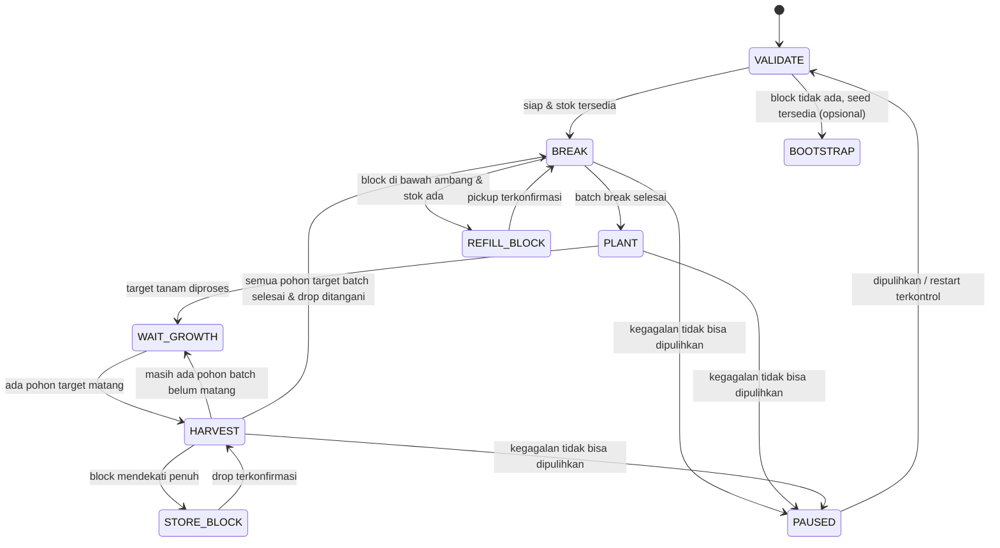

# CONTEXT.md — Konteks Pengembangan Pabrik Growblox

> **Terakhir disusun:** 8 November 2026  
> **Sumber:** pembacaan statis source aktif `k .lua` dan laporan pengujian pengguna.  
> **Status:** roadmap Pabrik nomor 0-9 telah dipatch secara statis. Semua flow, storage, dan collector masih memerlukan pengujian runtime terotorisasi sebelum dinyatakan reliabel.

## 1. Tujuan pengguna

Pengguna ingin memperbaiki **Pabrik** yang terasa buggy dan sulit diprediksi. Target utamanya:

1. Membuat urutan kerja yang eksplisit: **BREAK → PLANT → WAIT_GROWTH → HARVEST → REPEAT**.
2. Memastikan fase **HARVEST memindai semua pohon target** sesuai area pengaturan (`WholeWorld` bila diaktifkan) dan tidak meninggalkan pohon matang yang layak dipanen karena inventory hampir penuh.
3. Menambahkan **Block Storage Point** untuk menaruh block hasil panen ketika inventory mendekati penuh, kemudian kembali melanjutkan Harvest.
4. Menambahkan **Auto Refill Blocks** untuk mengambil kembali block dari lokasi penyimpanan ketika fase Break kekurangan block.
5. Mempertahankan kompatibilitas fitur lain dan menghindari loop tanpa progress.

Pengguna ingin menyelesaikan perubahan kode melalui **Codex**. Filter platform tanam telah menjadi patch awal; pekerjaan berikutnya tetap harus mengikuti rencana bertahap dan persetujuan sebelum mengubah flow/state Pabrik.

## 2. Gejala yang dilaporkan pengguna

- Urutan fase tidak jelas: kadang `plant → break → harvest`, bukan flow yang diinginkan.
- Pabrik tampak menangani pohon yang **belum matang** dalam sebagian sesi.
- Harvest dapat berhenti sebelum seluruh pekerjaan selesai.
- Kapasitas inventory mengganggu siklus.

Ini adalah **laporan runtime pengguna**. Penyebab spesifik pohon muda terkena aksi masih perlu bukti log dan pengamatan di world.

## 3. Kondisi implementasi yang dikonfirmasi dari source

| Komponen | Fakta terkonfirmasi | Lokasi perkiraan |
| --- | --- | --- |
| Inisialisasi fase | `pabrikStep(o)` memakai `o.phase = o.phase or "panen"` | `k.lua:5731–5735` |
| Mode Pabrik normal | `pabrikLoop` membuat `o.breakMode = "always"` | `k.lua:5809–5811` |
| PANEN → TANAM | `fieldStep()` mengembalikan `idle`, atau block/seed mencapai `CAP-20` | `k.lua:5743–5756` |
| TANAM → BREAK | Pindah setelah pekerjaan tanam menjadi `idle` atau seed tidak ada | `k.lua:5759–5767` |
| BREAK → BREAK/TANAM | Setelah `pabrikBreak()`, masih ada block berarti tetap BREAK; selain itu TANAM | `k.lua:5769–5782` |
| TUNGGU | Dapat berpindah ke PANEN, BREAK, atau TANAM berdasarkan kondisi dan timer | `k.lua:5784–5800` |
| BREAK memanggil Auto Farm | `State.Override = {... mode="Place + Break"}` lalu `farmLoop` | `k.lua:5493–5544` |
| Watchdog BREAK | Menghentikan sesi jika seed mencapai ambang, drop perlu dilakukan, atau tidak ada perubahan jumlah Placed/Broken selama 8 detik | `k.lua:5515–5528` |
| Nilai `BreakSec` | `Pabrik.BreakSec = 60` dideklarasikan tetapi tidak ditemukan dipakai di kontrol sesi BREAK saat ini | `k.lua:194` |
| Metadata pohon | `treeReadyAt()` memakai `t.p + (it.grow or 0)` | `k.lua:4570–4578` |
| Filter jenis panen | `farmerScan()` mendukung `FC.only`, tetapi `pabrikCfg()` tidak mengisinya | `k.lua:5467–5490`, `4750` |
| Batas stock | `CAP=190`, PANEN mengecek `CAP-20=170`, default `Pabrik.DropAt=200`, `Keep=50` | `k.lua:187–208`, `5465`, `5746` |
| Drop yang tersedia | `dropItems()`, `dropTrip()`, `Pabrik.Zone` sudah ada, terutama dipakai untuk drop seed | `k.lua:5570–5685` |
| Zone collector | Sebagian collector mengecualikan radius sekitar titik `Pabrik.Zone` | `k.lua:2134–2161`, `3771–3794` |
| Konfigurasi Pabrik | `Config.add("Pabrik", ...)` menyimpan seed, area, posisi/grid break, drop seed | `k.lua:1166–1169` |

**Penting:** `Pabrik.start()` menonaktifkan beberapa fitur lain, tetapi tidak terlihat menonaktifkan `Build` dan `Vend` pada jalur start yang diperiksa (`k.lua:5872–5910`). Periksa kembali konsekuensi kontrol gerak bersama sebelum implementasi.

## 4. Hipotesis yang perlu diuji

| Gejala | Kandidat penyebab | Apa yang harus diamati |
| --- | --- | --- |
| Pohon muda terkena aksi | Break Grid beririsan dengan tile pohon; `tryBreak()` dijalankan tanpa gate kematangan yang sama dengan jalur Harvest | Koordinat Break Grid, ID item, mode aksi, kematangan saat pukulan |
| Pohon dianggap siap terlalu cepat | `it.grow` hilang sehingga fallback `0`, atau `Refs.Trees` stale/tidak lengkap | Waktu tanam, `it.grow`, waktu server, data tree entry |
| Harvest berhenti terlalu awal | Transisi saat block/seed `>=170` langsung ke TANAM | Inventory sebelum transisi, count pohon mature vs immature |
| BREAK loop/stall | Retain BREAK selagi block `>0`, watchdog hanya melihat Placed/Broken, atau setpoint drop tidak sinkron | `from/to phase`, jumlah hits, Placed/Broken, inventory, alasan stop |
| Drop terkumpul ulang | Area storage dekat lintasan gerak, collector lain atau native pickup masih aktif | Posisi player, posisi drop, collector aktif, perubahan inventory |
| Klaim aksi sukses tidak sesuai server | `plantSeed()` memanggil `sendSetTile()` tetapi tidak memeriksa hasilnya sebelum mengurangi inventory lokal dan menaikkan counter | Perubahan tile/inventory server setelah operasi, error jaringan |

Jangan menyatakan hipotesis sebagai penyebab pasti sebelum ada log atau tes yang memadai.

## 5. Desain target nomor 1-8 (telah dipatch secara statis, belum diuji runtime)

Flow ini **rancangan**, bukan fungsi yang sudah ada di `k.lua`.

### Kontrak fase yang diusulkan

| Fase | Prasyarat | Selesai jika | Jangan lakukan |
| --- | --- | --- | --- |
| `VALIDATE` | Data world, seed, area, path & target tersedia | Semua validasi minimum lulus | Melanjutkan dengan referensi stale |
| `BREAK` | Block tersedia (inventory atau stock) dan grid valid | Batas batch yang disepakati tercapai; tidak hanya bergantung pada `blocks > 0` | Memukul pohon belum matang atau loop gagal tanpa batas |
| `REFILL_BLOCK` | Stok yang diketahui tersedia dan jalur ke storage dapat ditempuh | Jumlah block yang diambil tervalidasi | Mengambil semua item sekitar storage secara membabi buta |
| `PLANT` | Ada seed dan tempat tanam valid | Semua tile valid dalam batch telah diproses atau punya alasan skip | Menghitung penanaman gagal sebagai sukses |
| `WAIT_GROWTH` | Ada target batch yang belum matang | Minimal satu target matang dan data valid | Menganggap tree data hilang = matang |
| `HARVEST` | Ada target matang yang benar, path dapat ditempuh | Semua target matang ditangani; bila target belum matang tersisa, kembali menunggu | Keluar hanya karena inventory hampir penuh |
| `STORE_BLOCK` | Storage valid dan block mencapai ambang | Drop terkonfirmasi dan state Harvest dapat dipulihkan | Mengubah fase utama menjadi Plant/Break |
| `PAUSED/ERROR` | Terjadi kondisi yang tidak bisa dipastikan/ditangani | Pemulihan eksplisit | Spin tanpa progress dan tanpa status |

### Kebijakan 'Harvest seluruh world'

- Jika `Pabrik.WholeWorld = true`, pemindaian memakai batas world; jika false, area hanya wilayah lahan.
- Prioritaskan **hanya jenis seed Pabrik**; pohon lain tidak boleh masuk target yang sama tanpa keputusan desain baru.
- Pisahkan hitungan `ready`, `growing`, `unreachable`, `unknown` (data pohon tidak valid), dan `completed`.
- Pengguna menginginkan siklus batch yang dapat dituntaskan: **jangan mulai BREAK baru ketika masih ada pohon target dalam batch yang belum matang**, kecuali pengguna nanti memilih mode produksi yang overlapping.
- Bila masih ada pohon siap tetapi unreachable, jangan menandai fase selesai secara diam-diam: retry terbatas lalu tampilkan kondisi khusus.
- Simpan informasi batch/target agar pindah lokasi dan interupsi storage tidak membuat target hilang atau terproses dua kali.

## 6. Rencana Block Storage (belum ada)

### A. `Set Block Storage Point`

- Opsi UI untuk menyimpan world serta koordinat titik drop block.
- Dipisahkan dari `Pabrik.DropWorld`, `DropX`, `DropY` yang saat ini ditujukan untuk seed.
- Pilih lokasi dekat BREAK namun **bukan** pada Break Grid, jalur karakter, atau tile yang membuat drop terkubur/otomatis terambil.
- Pastikan data storage tervalidasi setelah pindah world/rejoin.

### B. `Auto Store Blocks`

Saat HARVEST dan block mencapai ambang batas:

1. Suspend pekerjaan Harvest dan simpan konteks fase/target.
2. Lepas kontrol gerak sebelumnya, pergi ke Block Storage Point.
3. Drop hanya **ID block terpilih**, sejumlah `jumlah - keep`, dengan mekanisme yang telah diaudit.
4. Verifikasi perubahan inventory dan keberadaan drop bila datanya bisa diamati.
5. Kembali ke area pekerjaan; **resume HARVEST**.
6. Jika gagal: tampilkan error/retry terbatas, **jangan** lompat ke fase lain.

Ambang contoh dari diskusi: drop saat block `>=170`, sisakan `30`, jadi bila berisi 170 akan mencoba menyimpan 140. **Angka ini usulan, belum menjadi spesifikasi final**.

### C. `Auto Refill Blocks`

Saat BREAK dan block mendekati habis:

1. Suspend BREAK (bukan menandainya selesai).
2. Periksa apakah ada stok block yang benar di titik storage.
3. Menuju titik storage; ambil **hanya item ID target** sampai jumlah yang dibutuhkan.
4. Verifikasi kuantitas dan bahwa drop tidak terambil dua kali.
5. Kembali ke BREAK dan lanjutkan batch.
6. Jika stok kosong/hilang/tidak bisa dicapai, tampilkan alasan dan aturan fallback yang eksplisit.

Contoh ambang yang **belum diputuskan**: refill saat `<=10`, target inventory `150`, tidak melewati limit yang berlaku.

### D. Storage zone dan pickup

- Implementasi saat ini memakai `Pabrik.Zone` tunggal untuk mencegah pengambilan drop pada sebagian collector. Desain baru kemungkinan membutuhkan `SeedDropZone` dan `BlockStorageZone` terpisah atau daftar zona bertipe.
- Saat restock, beri izin **sementara** untuk mengambil block tertentu yang telah dipilih di storage, lalu kembalikan proteksi zone.
- Jarak aman dari Break Grid lebih penting daripada menaruh drop tepat di tile break, karena native pickup saat bersentuhan belum tentu dapat dinonaktifkan.
- **Jangan berasumsi** item drop selalu persisten, memiliki kepemilikan eksklusif, atau tidak bisa diambil orang lain.

## 7. Catatan atas keputusan yang masih terbuka

| Keputusan | Kondisi saat ini |
| --- | --- |
| Siklus batch harus menunggu seluruh pohon target matang? | **Arah preferensi:** ya; perlu konfirmasi perilaku untuk tree unreachable/missing data |
| Awal Pabrik ketika hanya ada seed dan tidak ada block? | Pertimbangkan `BOOTSTRAP` terpisah, jangan membingungkan urutan normal |
| Definisi BREAK selesai | Belum disepakati: target seed, jumlah block, waktu, atau kombinasi |
| Ambang Store/Refill dan Keep | Angka contoh ada, **belum final** |
| Storage di world sama/berbeda? | Preferensi praktis: dekat BREAK, tetapi di luar jalur dan grid aktif |
| Cara mengidentifikasi drop simpanan | Harus ditentukan berdasarkan data drop yang benar-benar tersedia |
| Stock drop hilang, dijarah, atau terambil otomatis | Perlu kebijakan fallback, retry dan notifikasi |
| Penanganan pohon mature tetapi tidak terjangkau | Retry terbatas, status jelas, tidak silently complete |
| Batch yang menunggu lama | Tetap `WAIT_GROWTH` atau dukung mode overlapping sebagai opsi terpisah nanti |

## 8. Risiko lintas modul

- **Shared `FC`:** Farmer dan Pabrik memakai mesin tanam/panen yang sama; perubahan filter dan scan harus diuji agar Farmer tidak rusak.
- **Shared `farmLoop`:** Pabrik BREAK mengisi `State.Override` dan memakai Auto Farm; perubahan status/loop berdampak pada Auto Farm biasa.
- **Shared movement:** `AutoInput` dipakai beberapa controller; perjalanan storage berpotensi bertabrakan dengan Build, Vend, Farmer, Clear, dan Guard.
- **Shared drop:** `Pabrik.Zone` juga dibaca oleh collector lain; modifikasi zone perlu mempertimbangkan Farmer/Auto Farm.
- **Keandalan server:** request place/break/collect/drop tidak boleh disamakan dengan bukti sukses; cek data aktual.
- **Perubahan world:** `Refs.World`, `Refs.Trees`, inventory, dan data drop bisa berubah ketika world/rejoin.
- **Cleanup:** pekerjaan background harus selesai atau batal ketika `Pabrik.stop()` atau `Session.Cleanup` dipanggil.

## 9. Rencana implementasi bertahap di Codex (jika diminta)

> **Catatan status:** uraian Tahap 0 di bawah adalah baseline dokumentasi historis. Sesudah baseline tersebut, nomor 9 (*Selected Plant Platform*) telah dipatch secara statis. Tahap 1-5 untuk flow, harvest/growth, storage, dan regresi tetap belum diimplementasikan atau disetujui.

**Tahap 0 — hanya dokumentasi:** `README.md`, `AGENTS.md`, dan `CONTEXT.md`. **Tidak mengubah `k.lua`.**

**Tahap 1 — observability:** instrumentasi transisi fase, jumlah block/seed, alasan penundaan, tree state, dan kegagalan navigasi/aksi.

**Tahap 2 — state machine:** eksplisitkan `VALIDATE`, `BREAK`, `PLANT`, `WAIT_GROWTH`, `HARVEST`, `PAUSED/ERROR` dan aturan resume; pastikan siklus tidak berubah acak.

**Tahap 3 — keandalan Harvest:** filter target seed, proteksi tree muda, hasil panen/penanaman terverifikasi, retry bounded.

**Tahap 4 — Block Storage:** UI/konfigurasi titik, zone proteksi, drop/resume Harvest, refill/resume Break.

**Tahap 5 — regresi:** uji flow end-to-end, stop, world transition, inventory penuh/kosong, drop hilang, path gagal, tree stale.

Tahapan 1–5 **belum dikerjakan atau disetujui untuk dijalankan** berdasarkan permintaan dokumentasi saat ini.

## 10. Matriks uji yang disarankan

| Kasus | Ekspektasi |
| --- | --- |
| Start dengan block + seed valid | Mulai dari BREAK pada flow normal |
| Start tanpa block tetapi ada seed | Masuk fallback bootstrap yang eksplisit, jika disetujui |
| BREAK stok menipis | REFILL_BLOCK → kembali ke BREAK tanpa reset batch |
| HARVEST inventory mencapai ambang | STORE_BLOCK → kembali ke HARVEST pada target yang belum selesai |
| Semua pohon matang | Harvest semua target terjangkau dan terverifikasi |
| Pohon muda masih ada | Jangan dirusak; kembali `WAIT_GROWTH` |
| Pohon jenis lain ada di world | Tidak ikut dalam batch target Pabrik |
| Pohon matang unreachable | Retry bounded, tampilkan status; jangan hilangkan dari daftar |
| Data tree tidak tersedia | Jangan mengasumsikan matang; tampilkan status unverified |
| Drop storage terlalu dekat tile break | Tidak tercipta siklus drop-pickup otomatis |
| Stok drop hilang / ID berbeda | Tidak menambah counter stok palsu; fallback jelas |
| Inventory penuh atau kapasitas berubah | Tidak memproses item berlebih secara diam-diam |
| Stop pada navigasi, drop, atau Break | Gerakan/loop/override berhenti dengan aman |
| Rejoin atau pindah world | Referensi diperbarui, state tidak membuat aksi salah world |

## 11. Persyaratan laporan audit selanjutnya

Untuk setiap bug, dokumentasikan: **gejala → bukti fungsi/baris → hipotesis → kondisi reproduksi → tingkat keyakinan → risiko → rekomendasi → hasil uji**. Jika kemudian dilakukan patch, catat fungsi yang berubah serta tes yang benar-benar dijalankan.

### Ringkasan status

- **Ada saat ini:** Auto Farm, navigasi A*, Farmer, Pabrik dengan fase dinamis, drop seed, dan satu zona pengecualian drop.
- **Dilaporkan bermasalah:** urutan fase Pabrik, konsistensi Harvest, pengaruh inventory penuh.
- **Dikonfirmasi dari source:** awal default `panen`, transisi fase dinamis, threshold yang tidak konsisten, filter `FC.only` tidak diatur di `pabrikCfg()`.
- **Belum terverifikasi di runtime:** sumber pasti aksi pada pohon belum matang, sifat pickup/persistensi drop, efek penolakan server.
- **Direncanakan tetapi belum dibuat:** siklus Pabrik deterministik, Block Storage Point, Auto Store Blocks, Auto Refill Blocks, proteksi storage terpisah.

## 12. Pembaruan implementasi - Filter block penyangga Pabrik

**Status:** diimplementasikan secara statis pada `k .lua`; belum diuji runtime Roblox.

- `Pabrik.SupportFilter` dan `Pabrik.SupportId` adalah konfigurasi persisten. Pilihan disimpan sebagai `ItemId`, bukan nama tampilan.
- UI Pabrik menyediakan toggle **Enable Support Block Filter** dan dropdown **Plant Only Above**. Nilai dropdown dibangun dari `ItemDB` untuk block yang ditandai `solid` atau `platform`.
- `pabrikCfg()` memasang predicate `plantOk` hanya pada konfigurasi `FC` milik Pabrik. `farmerScan()` dan `farmerWorkInReach()` hanya menghormatinya bila predicate tersedia; Farmer dan Auto Splice tidak memasangnya sehingga perilakunya tidak berubah.
- `plantSpotOk()` tidak diubah. Sesudah filter penyangga lolos, seluruh validasi lokasi tanam yang sudah ada tetap dijalankan.
- Filter bekerja baik pada Whole World maupun Lahan karena diterapkan saat kandidat tanam dipilih, setelah pembatas area yang sudah ada.
- Bila scan PLANT tidak menemukan posisi yang cocok, fase mengikuti transisi Pabrik yang sudah ada tanpa retry loop tambahan dan status Pabrik menunjukkan `tidak ada posisi cocok saat ini`.
- Fitur ini tidak memodifikasi fase HARVEST, `treeReadyAt()`, atau pemeriksaan kematangan pohon.

## 13. Status roadmap Pabrik saat ini

| No. | Fitur / perbaikan | Status |
| --- | --- | --- |
| 0 | Observability transisi fase dan inventory Pabrik | Diimplementasikan secara statis; belum diuji runtime |
| 1 | Flow deterministik `BREAK -> PLANT -> WAIT_GROWTH -> HARVEST -> REPEAT` | Diimplementasikan secara statis; belum diuji runtime |
| 2 | Harvest seluruh tree target yang dipindai | Diimplementasikan secara statis: filter seed target dan retry target unreachable; belum diuji runtime |
| 3 | Wait until trees mature | Diimplementasikan secara statis: tree growing ditunggu, metadata hilang menjadi `PAUSED`; belum diuji runtime |
| 4 | Set Block Storage Point | Diimplementasikan secara statis: world/koordinat persisten dan validasi dasar; belum diuji runtime |
| 5 | Auto Store Blocks | Diimplementasikan secara statis: suspend HARVEST, drop Item ID block di storage, verifikasi inventory, lalu resume HARVEST; belum diuji runtime |
| 6 | Auto Refill Blocks | Diimplementasikan secara statis: suspend BREAK, collect hanya Item ID block target, verifikasi target refill, lalu resume BREAK; belum diuji runtime |
| 7 | Block Storage Protection | Diimplementasikan secara statis: zona storage terpisah dikecualikan oleh collector script; native pickup belum terverifikasi |
| 8 | Perbaikan inventory threshold dan recovery | Threshold persisten dan pause aman diimplementasikan secara statis; Auto Store/Refill masih terpisah |
| 9 | Selected Plant Platform / Support Block Filter | Diimplementasikan secara statis; belum diuji runtime |
| 10 | Hardening lifecycle, konflik controller, I18N, dan checklist regresi | Diimplementasikan secara statis; belum diuji runtime |

Rencana detail dan urutan pengerjaan berada di `docs/implementation-plans.md`. Status pada dokumen tersebut mencatat patch statis; dokumen itu bukan bukti keberhasilan runtime.

## 14. Status hardening dan verifikasi

- `Pabrik.start()` kini menghentikan Build dan Vending agar tidak ada controller gerak kedua yang aktif.
- `Pabrik.stop()` dan `Session.Cleanup` mereset `Move.NoZone`, sehingga izin pickup storage sementara tidak bocor ke sesi berikutnya.
- Label konfigurasi storage/inventory mengikuti kamus I18N Indonesia/English.
- Pemeriksaan statis dilakukan untuk alur state, konfigurasi persisten, helper storage, dan call-site collector. Tidak ada executor, remote game, atau tes Roblox runtime yang dijalankan.
- Uji runtime terotorisasi yang masih wajib: success/failure place-break, kematangan tree, storage drop hilang/diambil pemain lain, refill partial, world transition, stop di tengah navigasi, dan script re-execution.

## 15. WindUI loader (8 November 2026)

- Loader WindUI pada `k .lua` memakai distribusi raw resmi Footagesus yang dipin ke tag `1.6.66`: `https://raw.githubusercontent.com/Footagesus/WindUI/1.6.66/dist/main.lua`. Endpoint asset rilis resmi untuk tag yang sama pernah mengembalikan `504 Gateway Timeout`; endpoint raw tag merespons `200` saat pemeriksaan read-only. Keduanya merujuk distribusi resmi Footagesus.
- Sebelum source remote dikompilasi, loader memeriksa kegagalan HTTP, tipe respons, respons kosong, serta ciri HTML/error page. Respons `504 Gateway Time-out` berbentuk HTML dilaporkan sebagai kegagalan terkendali dan tidak dieksekusi.
- Hasil `loadstring`, eksekusi library, dan keberadaan `CreateWindow` divalidasi. `CreateWindow` juga dibungkus `pcall`; bila gagal, sesi awal dibatalkan sebelum komponen GUI lanjutan dibuat.
- Perubahan ini hanya diverifikasi secara statis. Keberhasilan download dan kompatibilitas runtime dengan executor masih memerlukan pengujian terotorisasi.

## 16. Perbaikan batas inventory Pabrik (8 November 2026)

- Runtime melaporkan `attempt to perform arithmetic (sub) on nil and number` pada kontrol Inventory Pabrik yang menghitung `CAP - 1`. Error tersebut menghentikan konstruksi UI sebelum tab Koneksi dibuat.
- Batas aman Pabrik kini dimiliki oleh `Pabrik.InventoryCap` dengan fallback `190`; slider Pabrik dan seluruh pemeriksaan kapasitas seed Pabrik memakai nilai ini, bukan `CAP` bersama.
- `InventoryCap` bukan pengaturan pengguna dan tidak dipersistenkan. Pemakaian `CAP` oleh Build tidak diubah dalam patch ini.
- Patch hanya diperiksa secara statis; buka UI Pabrik lalu tab Koneksi pada runtime terotorisasi untuk verifikasi.
