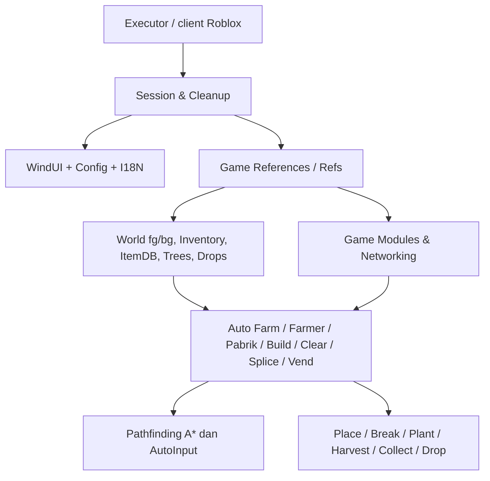

# Kzoyz x Opus — Growblox Automation Script

> **Status:** Dokumentasi berdasarkan pembacaan statis source aktif `k .lua` (snapshot 8 November 2026). Roadmap Pabrik (state machine, tree growth/harvest, storage, store/refill, dan Selected Plant Platform) telah dipatch secara statis. Ini **bukan** klaim bahwa semua fitur telah berhasil diuji di runtime.

## Ringkasan proyek

`k .lua` adalah script **Luau sisi client** untuk experience Roblox **Growblox**, yang terinspirasi oleh konsep gameplay Growtopia. Script memanfaatkan layanan Roblox, modul yang direplikasi ke client, dan beberapa kemampuan khusus executor untuk menampilkan GUI dan mengotomatisasi aktivitas dalam world berbasis tile. Antarmuka menggunakan **WindUI** yang dimuat saat runtime.

Growblox dan Growtopia **tidak boleh diasumsikan memiliki protokol, batas item, validasi server, atau mekanik internal yang identik**. Penjelasan teknis di sini didasarkan pada implementasi yang terlihat di `k .lua`, bukan dokumentasi resmi server Growblox.

Dokumentasi pendamping:
- [`AGENTS.md`](AGENTS.md): aturan kerja untuk Codex/agen pengembang.
- [`CONTEXT.md`](CONTEXT.md): hasil audit, keputusan yang sedang dipertimbangkan, dan arah pengembangan **Pabrik**.

## Struktur yang tersedia

```text
project/
├── k .lua       # sumber utama Luau (monolitik; nama saat ini mengandung spasi sebelum .lua)
├── README.md    # gambaran proyek dan arsitektur
├── AGENTS.md    # aturan kerja agen coding
└── CONTEXT.md   # konteks audit Pabrik dan rencana pengembangan
```

Struktur di atas mencerminkan file yang tersedia untuk tugas dokumentasi ini. Jangan menyimpulkan bahwa tidak ada file lain pada repo pengguna tanpa memeriksa repo sebenarnya.

## Fitur yang terlihat di source

| Subsistem | Tanggung jawab utama | Referensi di `k .lua` |
| --- | --- | --- |
| Auto Farm | Pilih grid relatif terhadap pemain, place/break, collect, statistik | `State`, `farmLoop`, `startFarm` |
| Auto Clear | Membersihkan tile world dan mengelola pijakan | `Clear`, `startClear` |
| Farmer | Pemindaian pohon matang, harvest, plant, collect | `Farmer`, `fieldStep`, `farmerScan` |
| Auto Splice | Tanam seed A, splice seed B, opsi roaming | `Splice` |
| Pabrik | Menggabungkan harvest, plant, break, wait, dan drop seed | `Pabrik`, `pabrikStep`, `pabrikLoop` |
| Bangun Lahan | Menggali, memasang baris lahan, produksi block jika diperlukan | `Build`, `Land` |
| Vending | Mengisi atau mengambil stok dari vending | `Vend` |
| Auto Path | Navigasi A* pada world 2D, gerakan & obstacle | `astar`, `followPath`, `travelGroup` |
| Collect/Drop | Mendata drop world, sentuhan/remote, drop ke titik | `Drops`, `Move.fetchDrops`, `dropTrip` |
| Pengaturan & UI | WindUI, terjemahan Indonesia/English, penyimpanan konfigurasi | `UI`, `I18N`, `Config` |
| Fitur tambahan | Guard, chat otomatis, statistik, Discord webhook, rejoin, bonus, scan world, tas | `Guard`, `Spam`, `Hook`, `Rejoin`, dll. |

**Catatan:** tabel menjelaskan subsistem yang tampak ada di source, bukan jaminan kompatibilitas pada versi Growblox yang sedang berjalan.

## Ringkasan arsitektur



### Session dan eksekusi

- `getgenv()` atau `_G` dipakai untuk menyimpan instance sesi `__KzoyzOpus` dan membersihkan sesi lama `__GTFarm`.
- `Session.Cleanup` pada akhir file menghentikan berbagai loop/flag, mengembalikan hook tertentu, melepas input, memutus koneksi, dan menghancurkan GUI.
- `alive()` memeriksa apakah sesi yang sedang berjalan masih merupakan instance aktif.
- `Session.Exec` dan `UI.exec()` menangani pemanggilan pekerjaan dalam konteks eksekusi yang tersedia; beberapa API terkait identity spesifik executor.

### Data world dan modul

- `Refs.World` digunakan untuk representasi world, termasuk grid `fg` (foreground), `bg` (background), dimensi `w` dan `h`, serta sebagian fungsi terkait world.
- `ItemDB` memuat metadata item yang dibaca oleh script, misalnya jenis item, jumlah pukulan, dan durasi pertumbuhan jika tersedia.
- `Refs.Inv` dipakai oleh fungsi seperti `invCount()` dan pemeriksaan ruang inventory.
- `Refs.Trees` serta `Auto.treeEntry()` mendukung penentuan kesiapan pohon melalui `treeReadyAt()`.
- `Drops.list` merepresentasikan drop yang teramati di world, dengan logika pengambilan dan retry.
- `Shared.Net`, `WorldRemotes.SetTile`, dan fungsi game yang berhasil ditemukan dipakai sebagai jalur komunikasi; mekanisme fallback dan penerimaan oleh server **perlu diuji**.

### Auto Farm

`farmLoop(runId)` (sekitar baris **2470**) menjalankan loop selama `State.Running`, session, dan `RunId` masih valid:

1. Menentukan target grid dari posisi pemain dan `Offsets`.
2. Mengambil drop yang tersedia berdasarkan `CollectMode`.
3. Menempatkan block pada tile yang memenuhi syarat (`tryPlace`).
4. Memukul target (`tryBreak`) dengan penjadwalan `MultiTarget` dan jeda.
5. Memperbarui statistik serta memeriksa ketersediaan block dan pembatalan.

Mode: `Place + Break`, `Break saja`, `Place saja`. Jeda default yang tampak pada `State` adalah `PlaceMs=250`, `BreakMs=220`, `AfterBreakMs=300`; nilai aktual dapat diubah atau dibatasi oleh konfigurasi. Nilai timing ini adalah pengaturan script, **bukan ukuran pasti limit server**.

### Auto Path / gerakan

- Algoritma `astar()` (sekitar baris **2928**) menghasilkan jalur sesuai representasi tile dan perkiraan fisika game.
- `followPath()` (sekitar **3453**) melaksanakan langkah berjalan, melompat, jatuh, melewati gap, dan kasus pijakan/tangga.
- `travelGroup()` (sekitar **3521**) menavigasi ke kelompok target; ada pencatatan jalur/target gagal dan skip sementara.
- `AutoInput` dan pembungkus kontrol `WorldMenu.isDown` dipakai untuk mengarahkan karakter menggunakan sistem input game, bukan sekadar teleport posisi.
- Pathfinding berbagi state dan kontrol dengan beberapa fitur. Perubahan navigasi harus memperhatikan konflik antar-automa.

### Farmer dan pertumbuhan pohon

- `treeReadyAt(x,y,id)` (sekitar **4570**) memakai metadata seed dan data waktu tanam; mengembalikan waktu siap atau `nil` bila informasi tidak ada.
- `farmerScan()` (sekitar **4735**) memindai target yang matang dan tile tanam; `fieldStep()` (sekitar **4871**) mengatur aksi lokal dan navigasi ke target.
- Mesin `FC` (konfigurasi Farmer) digunakan bersama oleh Farmer dan Pabrik. Flag `harvest`, `plant`, `seed`, `only`, `area`, `plantSet`, `skip`, dan `row` memengaruhi pekerjaan.
- Data pertumbuhan yang hilang/tidak valid harus dibedakan dari pohon yang benar-benar siap.

### Pabrik saat ini (as-is)

`Pabrik` (sekitar **187**), `pabrikCfg()` (**5467**), `pabrikBreak()` (**5493**), `pabrikStep()` (**5731**), `pabrikLoop()` (**5809**), `Pabrik.start()` (**5872**).

Kondisi saat ini **bukan** siklus kaku `BREAK → PLANT → HARVEST`. Pada `pabrikStep`, fase yang belum diatur default ke **`panen`**; `tanam`, `break`, dan `tunggu` dapat saling dipilih berdasarkan inventory, pohon, dan readiness. Break memakai `farmLoop()` dengan `State.Override`, sedangkan penanaman/panen memakai `fieldStep()`.

Pabrik mempunyai opsi area lahan atau seluruh world (`WholeWorld`) dan fasilitas drop seed. Masalah flow, validasi, serta rencana penyimpanan block didokumentasikan lebih rinci di [`CONTEXT.md`](CONTEXT.md).

Tambahan yang telah dipatch secara statis adalah **Selected Plant Platform / Support Block Filter**: fase PLANT dapat dibatasi ke tile yang berada di atas Item ID block penyangga pilihan. Konfigurasi ini khusus Pabrik, tersimpan melalui config, dan tidak mengubah HARVEST maupun pemeriksaan kematangan tree. Pengujian runtime belum dilakukan.

### Inventory, drop, dan perjalanan

- `dropItems(id,n,live)` menggunakan fungsi drop yang ditemukan dari HUD game dan membandingkan jumlah item sebelum/sesudah operasi.
- `dropTrip(items,live,say)` menangani perjalanan ke titik drop dalam world yang sama/berbeda, kemudian kembali.
- `Pabrik.Zone` menandai satu area pengecualian agar sebagian collector script tidak otomatis mengambil drop di sana. Hal ini **tidak membuktikan** bahwa pickup bawaan game akan terhalang.
- `Move.fetchDrops()` dan collector yang berjalan berkala dapat membaca serta mengambil drop world; keberhasilan dipengaruhi aturan server, jarak, path, dan ruang inventory.
- Pada source ini, drop Pabrik yang langsung dipicu oleh controller adalah **drop seed**, belum terdapat pengelola stok block Pabrik yang dirancang pengguna.

### UI, bahasa, config

- WindUI diambil melalui URL GitHub release `latest` dan dieksekusi dengan `loadstring` (sekitar baris **50**). Dependensi jarak jauh dapat berubah; audit versi yang digunakan sebelum menjalankan di lingkungan penting.
- `I18N` menyimpan bahasa Indonesia/English; teks baru sebaiknya mengikuti pola terjemahan yang ada.
- `Config` (sekitar **1020–1178**) menggunakan API file executor bila tersedia dan menyimpan JSON relatif ke `KzoyzOpus/config_<UserId>.json`, dengan autosave setiap ~3 detik. Folder fisik bergantung executor.
- `Config.add("Pabrik",...)` menyimpan seed, area, Break Grid/Position, pengaturan drop seed, serta `SupportFilter` dan `SupportId` untuk filter platform tanam; belum menyimpan titik storage block terpisah.

## Menjalankan dan menguji

Dokumentasi ini **tidak** menyatakan bahwa script telah dieksekusi atau dinyatakan aman. Pengujian sebaiknya dilakukan hanya pada world/lingkungan yang dimiliki atau diizinkan. Periksa script dan dependensi eksternalnya sebelum dijalankan; penggunaan executor dapat melanggar aturan experience/platform.

Prioritas pengujian pengembangan:

1. Start/stop dan `Cleanup` saat sedang farming, navigasi, atau drop.
2. Pergantian world, kematian karakter, serta referensi `Refs` yang berubah.
3. Inventory hampir penuh, kosong, dan penolakan operasi oleh server.
4. Tanaman matang vs belum matang, target yang tidak terjangkau.
5. Konflik mode otomatis yang menggunakan gerakan, input, atau state bersama.

## Arah pengembangan

**Pembaruan implementasi:** roadmap Pabrik nomor 0-9 sekarang telah dipatch secara statis. Bagian berikut yang memakai kata “direncanakan” adalah konteks desain historis dan tidak menggantikan status terbaru di `CONTEXT.md`. Validasi runtime tetap belum dilakukan.

**Status roadmap saat ini:** nomor 0-9 telah dipatch secara statis: observability, state machine, target tree/growth, threshold inventory, Block Storage Point/proteksi, Auto Store/Refill, dan Selected Plant Platform. Proposal serta checklist review berada di `docs/implementation-plans.md`; tes runtime masih wajib.

**Sedang ditinjau, belum diimplementasikan:** pengendali Pabrik yang deterministik (`BREAK → PLANT → WAIT_GROWTH → HARVEST → REPEAT`) serta `Set Block Storage Point`, `Auto Store Blocks`, dan `Auto Refill Blocks`. Rincian desain, risiko, dan keputusan yang belum ditetapkan ada di `CONTEXT.md`.

**Jangan menyamakan usulan dalam dokumentasi dengan fitur yang sudah tersedia di `k .lua`.**
